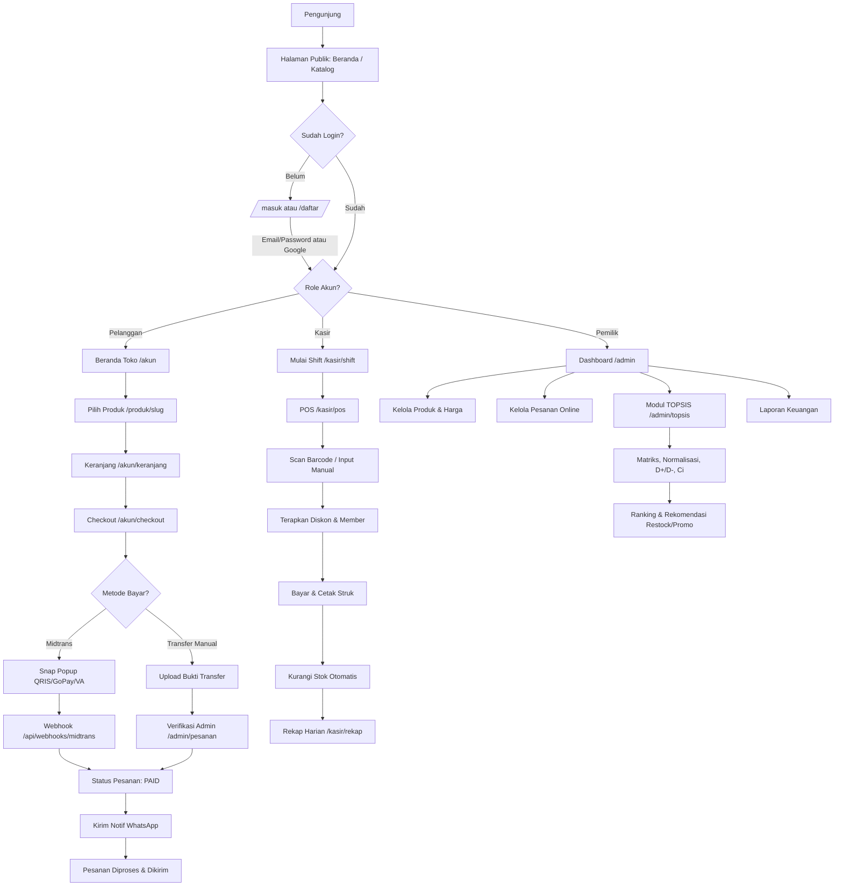

# Product Requirements Document (PRD): TokoTopsis

> Sistem Informasi Toko Kelontong berbasis Web dengan Sistem Pendukung Keputusan (SPK) Metode TOPSIS, POS Kasir, dan Toko Online.

---

## 1. Ringkasan & Tujuan Aplikasi

### Nama Aplikasi
**TokoTopsis** — Sistem Informasi Toko Kelontong berbasis Web dengan Sistem Pendukung Keputusan (SPK) Metode TOPSIS.

### Penjelasan Singkat
TokoTopsis adalah platform digital terpadu untuk mengelola toko kelontong modern yang menggabungkan operasional kasir (POS), toko online (e-commerce), dan kecerdasan analitik berbasis metode TOPSIS untuk membantu pemilik toko mengambil keputusan strategis (restock, promo, evaluasi produk). Sistem dibangun dengan arsitektur frontend Next.js 15 dan backend Laravel 11 REST API.

### Masalah yang Diselesaikan
1. Pemilik toko kelontong kesulitan menentukan produk mana yang harus di-restock, dipromosikan, atau dihentikan penjualannya karena tidak adanya analisis data yang objektif.
2. Proses transaksi manual (tulis nota, hitung uang) menyebabkan human error, lambat, dan sulit direkap harian.
3. Tidak ada kanal penjualan online sehingga jangkauan pelanggan terbatas pada sekitar toko saja.
4. Tidak ada pelacakan stok secara real-time sehingga barang sering kosong atau menumpuk (dead stock).
5. Sulit memantau loyalitas pelanggan dan produk bermasalah (retur/komplain).

### Pengguna Aplikasi (User Personas)
- **Pemilik Toko (Owner/Admin):** Pemilik bisnis yang membutuhkan dasbor analitik, manajemen produk/stok/harga, laporan pendapatan, dan hasil rekomendasi TOPSIS.
- **Kasir (Cashier):** Pegawai toko yang melayani transaksi offline (POS), cetak struk, kelola shift, dan rekap pendapatan harian.
- **Pelanggan (Customer):** Masyarakat umum yang berbelanja online, memilih produk, memesan, dan membayar via QRIS/Midtrans atau transfer manual.

### Target Keberhasilan (KPI)
- Meningkatkan efisiensi waktu transaksi kasir dari ±3 menit menjadi < 1 menit per transaksi.
- Menyediakan rekomendasi TOPSIS otomatis untuk minimal 6 kriteria (produk terlaris, dead stock, stok menipis, loyalitas pelanggan, margin keuntungan, tingkat retur).
- Meningkatkan omzet online sebesar 30% dalam 6 bulan pertama setelah peluncuran fitur e-commerce.
- Memangkas dead stock hingga 40% dalam 3 bulan dengan rekomendasi diskon/clearance berbasis data TOPSIS.
- Menghadirkan laporan pendapatan harian/bulanan yang akurat & real-time (zero manual rekapitulasi).

---

## 2. Batasan Pembuatan Sistem (Versi Awal MVP)

### ✅ Yang Dikerjakan:
- Autentikasi multi-role (Pemilik, Kasir, Pelanggan) menggunakan Email & Password + opsi Google OAuth + fitur Lupa Password via email.
- Manajemen produk: CRUD produk, kategori, harga jual, harga modal (untuk margin), stok, barcode, gambar, dan stok minimum (threshold).
- Modul Kasir (POS) offline: transaksi langsung, scan barcode, diskon/promo, cetak struk, shift kasir, void/refund, dan rekap harian.
- Toko online pelanggan: katalog produk, keranjang, checkout, alamat pengiriman, riwayat pesanan.
- Pembayaran online via Midtrans (Snap - QRIS/VA/GoPay/dll.) DAN Transfer Manual dengan upload bukti transfer + verifikasi admin.
- Modul TOPSIS Lengkap (6 kriteria): Perhitungan matriks, normalisasi, matriks terbobot, jarak solusi ideal (D+ / D-), nilai preferensi (Ci), dan perankingan.
- Dashboard analitik Pemilik: pendapatan, produk terlaris, grafik penjualan, dan hasil rekomendasi TOPSIS.
- Notifikasi WhatsApp Gateway untuk status pesanan & stok (contoh: Fonnte / Wablas / WhatsApp Cloud API).
- Manajemen pelanggan & member toko (tier diskon, poin loyalitas).

### ⛔ Yang Tidak Dikerjakan di Versi Awal:
- Fitur multi-cabang / multi-toko (single-tenant toko saja).
- Integrasi ekspedisi kurir otomatis (hanya input manual nomor resi).
- Sistem payroll/gaji pegawai.
- Aplikasi mobile native (Android/iOS) — fokus web responsif.
- Fitur marketplace multi-vendor.
- Live chat real-time antar pelanggan dan kasir (cukup via WhatsApp).

---

## 3. Daftar Halaman & Struktur Menu (Pages & Routing)

### A. Public Area (Tanpa Login — Frontend Next.js)
- `/` (Beranda): Hero section, produk unggulan, kategori populer, promo hari ini, testimoni pelanggan.
- `/produk` (Katalog Produk): Grid produk dengan filter kategori, harga, sorting, dan search.
- `/produk/[slug]` (Detail Produk): Gambar, harga, stok tersedia, deskripsi, ulasan, tombol "Tambah ke Keranjang".
- `/tentang` (Tentang Kami): Profil toko, alamat, jam operasional, peta.
- `/kontak` (Kontak): Form kontak, WhatsApp, dan info toko.
- `/masuk` (Login): Form login Email/Password + tombol "Masuk dengan Google".
- `/daftar` (Register): Form pendaftaran pelanggan baru.
- `/lupa-password` (Forgot Password): Input email untuk mengirim link reset.
- `/reset-password/[token]` (Reset Password): Form input password baru.

### B. Pelanggan Area (Setelah Login sebagai Customer)
- `/akun` (Dashboard Pelanggan): Ringkasan pesanan aktif, poin loyalitas, dan promo personal.
- `/akun/pesanan` (Riwayat Pesanan): Daftar semua pesanan + status pembayaran.
- `/akun/pesanan/[orderNumber]` (Detail Pesanan): Detail item, status, tombol bayar (Midtrans) atau upload bukti transfer, dan lacak pesanan.
- `/akun/keranjang` (Keranjang Belanja): Daftar item, kuantitas, subtotal, tombol checkout.
- `/akun/checkout` (Checkout): Form alamat, pilih metode pembayaran (Midtrans / Transfer Manual), konfirmasi.
- `/akun/alamat` (Buku Alamat): CRUD alamat pengiriman.
- `/akun/profil` (Profil): Edit nama, telepon, email, dan ubah password.

### C. Kasir Area (Setelah Login sebagai Cashier)
- `/kasir` (Dashboard Kasir): Rekap cepat transaksi hari ini.
- `/kasir/pos` (POS / Kasir Offline): Scan barcode, cari produk, input qty, diskon, halaman pembayaran, cetak struk.
- `/kasir/transaksi` (Riwayat Transaksi): Daftar transaksi offline + tombol void/refund.
- `/kasir/rekap` (Rekap Harian): Laporan pendapatan harian per metode pembayaran.

### D. Pemilik / Admin Area (Setelah Login sebagai Owner)
- `/admin` (Dashboard Analitik): KPI utama (omset, transaksi, margin, produk terlaris) + grafik.
- `/admin/produk` (Manajemen Produk): CRUD produk, upload gambar, atur harga jual & modal, stok min, barcode.
- `/admin/kategori` (Manajemen Kategori): CRUD kategori produk.
- `/admin/pesanan` (Manajemen Pesanan Online): Daftar pesanan, verifikasi bukti transfer, ubah status, kirim notifikasi WA.
- `/admin/pelanggan` (Manajemen Pelanggan): Daftar pelanggan, riwayat belanja, tier member, poin.
- `/admin/promo` (Manajemen Promo & Voucher): CRUD voucher diskon, promo produk.
- `/admin/topsis` (Modul TOPSIS - Kriteria): CRUD kriteria + bobot (benefit/cost) — 6 kriteria default.
- `/admin/topsis/perhitungan` (Modul TOPSIS - Perhitungan): Matriks keputusan, normalisasi, D+/D-, Ci, dan ranking.
- `/admin/topsis/rekomendasi` (Modul TOPSIS - Rekomendasi): Hasil ranking dengan insight rekomendasi actionable (restock, promo, clearance).
- `/admin/laporan` (Laporan Keuangan): Laporan pendapatan per periode, export PDF/Excel.
- `/admin/kasir` (Manajemen Kasir): CRUD akun kasir, atur shift, dan lihat performa.
- `/admin/pengaturan` (Pengaturan Toko): Info toko, WhatsApp gateway API key, Midtrans keys, profil owner.

---

## 4. Pedoman UI/UX & Design System

### Skema Warna
- **Primary:** `HSL(142, 70%, 45%)` — Hijau segar (kesan alami, toko kelontong, kesegaran produk)
- **Primary Hover:** `HSL(142, 70%, 38%)`
- **Secondary:** `HSL(32, 95%, 55%)` — Oranye hangat (CTA, badge promo)
- **Accent/Info:** `HSL(199, 89%, 48%)` — Biru langit untuk link & info
- **Status Colors:**
  - Success: `HSL(142, 71%, 45%)`
  - Warning: `HSL(38, 92%, 50%)`
  - Danger: `HSL(0, 84%, 60%)`
- **Background:** `HSL(60, 20%, 98%)` (putih gading hangat)
- **Card Background:** `HSL(0, 0%, 100%)`
- **Foreground/Text:** `HSL(215, 25%, 15%)`, Muted: `HSL(215, 16%, 47%)`

### Tipografi
- **Heading:** Plus Jakarta Sans (bold, modern, ramah)
- **Body:** Inter (clean, highly legible)
- **Angka/Harga:** JetBrains Mono (tabular-nums untuk nominal uang di POS)

### Aturan Komponen
- **Border radius:** `rounded-xl` (12px) untuk card, `rounded-lg` (8px) untuk button/input, `rounded-full` untuk badge/pill.
- **Card:** `shadow-sm border border-neutral-200`, saat hover: `shadow-md -translate-y-0.5 transition`.
- **Tombol:** Primary hijau solid dengan `hover:scale-[1.02]`, secondary outline.
- **Tabel:** Zebra striping lembut, header sticky, kolom aksi pakai icon.
- **Form:** Label di atas, pesan error merah kecil di bawah, input `focus:ring-2 focus:ring-primary/40`.
- **Nuansa & Vibe:** Fresh, friendly, dan modern-commerce. Banyak whitespace, ilustrasi flat minimalis kategori produk, micro-animation pada keranjang (bounce saat item masuk), toast notification saat aksi berhasil.

---

## 5. Pembagian Hak Akses Pengguna (Matrix RBAC)

| Menu / Halaman | Publik (Tanpa Login) | Pelanggan (Login) | Kasir (Login) | Pemilik / Admin (Login) |
|---|---|---|---|---|
| Beranda `/` | ✅ | ✅ | ✅ | ✅ |
| Katalog `/produk` | ✅ | ✅ | ✅ | ✅ |
| Detail Produk `/produk/[slug]` | ✅ | ✅ | ✅ | ✅ |
| Keranjang & Checkout | ❌ | ✅ | ❌ | ❌ |
| Riwayat Pesanan `/akun/pesanan` | ❌ | ✅ (milik sendiri) | ❌ | ✅ (semua) |
| POS Kasir `/kasir/pos` | ❌ | ❌ | ✅ | ✅ (view-only) |
| Riwayat & Void Transaksi `/kasir/transaksi` | ❌ | ❌ | ✅ | ✅ |
| Manajemen Shift `/kasir/shift` | ❌ | ❌ | ✅ | ✅ |
| Rekap Harian `/kasir/rekap` | ❌ | ❌ | ✅ | ✅ |
| Dashboard Analitik `/admin` | ❌ | ❌ | ❌ | ✅ |
| Kelola Produk & Kategori `/admin/produk` | ❌ | ❌ | ❌ | ✅ |
| Kelola Pesanan Online `/admin/pesanan` | ❌ | ❌ | ❌ | ✅ |
| Kelola Pelanggan & Member `/admin/pelanggan` | ❌ | ❌ | ❌ | ✅ |
| Kelola Promo & Voucher `/admin/promo` | ❌ | ❌ | ❌ | ✅ |
| Modul TOPSIS `/admin/topsis/*` | ❌ | ❌ | ❌ | ✅ |
| Laporan Keuangan `/admin/laporan` | ❌ | ❌ | ❌ | ✅ |
| Kelola Akun Kasir `/admin/kasir` | ❌ | ❌ | ❌ | ✅ |
| Pengaturan Toko `/admin/pengaturan` | ❌ | ❌ | ❌ | ✅ |

---

## 6. Alur Kerja dan Fitur Utama

### A. Autentikasi Multi-Role (Email/Password, Google OAuth, & Lupa Password)
- **Cara Kerja:**
  - Pengunjung mendaftar di `/daftar` dengan role default `customer`. Akun kasir dan admin dibuat oleh owner di `/admin/kasir`.
  - Login mendukung Email & Password atau tombol "Masuk dengan Google" (OAuth 2.0).
  - Lupa password via `/lupa-password` mengirim tautan token reset via email (berlaku 60 menit).
- **Aturan Sistem:**
  - Password minimal 8 karakter, kombinasi huruf & angka, di-hash dengan bcrypt.
  - Email unik (case-insensitive).
  - Token Google OAuth tersinkronisasi (jika email sudah ada maka login otomatis, jika baru maka auto-register customer).
  - Rate limiting login: maks 5 percobaan gagal / 15 menit per IP.

### B. Manajemen Produk & Stok (Pemilik)
- **Cara Kerja:** Pemilik membuka `/admin/produk`, klik "Tambah Produk", isi nama, kategori, harga modal, harga jual, satuan, stok, stok minimum, barcode, gambar, dan deskripsi.
- **Aturan Sistem:**
  - `harga_jual` wajib ≥ `harga_modal`.
  - Stok berkurang otomatis ketika ada transaksi POS selesai atau pesanan online lunas.
  - Muncul badge peringatan jika `stok <= min_stock`.
  - Upload gambar maksimal 2MB (jpg/png/webp) disimpan ke storage.

### C. Modul Kasir (POS Offline)
- **Cara Kerja:**
  - Buka shift di `/kasir/shift` dengan input kas awal.
  - Buka `/kasir/pos`, scan barcode produk / pencarian manual → produk masuk keranjang POS.
  - Input diskon/voucher/member, pilih pembayaran (Tunai/QRIS/Transfer), cetak struk.
  - Tutup shift: input kas akhir, sistem menghitung selisih uang.
- **Aturan Sistem:**
  - Void/Refund: hanya bisa dilakukan di hari yang sama dan butuh persetujuan owner; stok otomatis kembali.
  - Format invoice POS: `POS-{YYYYMMDD}-{counter}`.
  - Member tier (Bronze/Silver/Gold) dapat diskon otomatis 0%/3%/5%.
  - Semua transaksi POS menyimpan `cashier_id` dan `shift_id`.

### D. Toko Online & Checkout (Pelanggan)
- **Cara Kerja:** Pelanggan memilih produk di `/produk`, tambah ke keranjang, klik checkout di `/akun/checkout`, pilih alamat dan opsi pembayaran, lalu konfirmasi pesanan.
- **Aturan Sistem:**
  - Stok divalidasi ulang saat checkout.
  - Format nomor order: `ONL-{YYYYMMDD}-{counter}`.
  - Keranjang dibersihkan otomatis setelah order dibuat.

### E. Pembayaran Online (Midtrans Snap + Transfer Manual)
- **Cara Kerja:**
  - **Midtrans:** Sistem memanggil API Snap untuk membuat token transaksi, popup Snap muncul untuk bayar via QRIS/GoPay/VA.
  - **Transfer Manual:** Pelanggan transfer ke rekening BRI toko dan upload bukti bayar di detail pesanan. Admin memverifikasi di `/admin/pesanan`.
  - Webhook Midtrans (`POST /api/webhooks/midtrans`) menerima notifikasi status pembayaran dan memvalidasi signature SHA-512.
- **Aturan Sistem:**
  - Status pembayaran: `unpaid` → `paid` → `expired` / `refunded`.
  - Bukti transfer wajib JPG/PNG/PDF, maks 3 MB.
  - Batas waktu bayar 24 jam sebelum otomatis expired dan stok dikembalikan.

### F. Modul TOPSIS (Sistem Pendukung Keputusan Pemilik)
- **Kriteria Default (6 Kriteria):**
  - **C1: Produk Terlaris** (Total Penjualan) — *Benefit* (Bobot: 0.25)
  - **C2: Perputaran Barang Terlambat / Dead Stock** (Hari tanpa penjualan) — *Cost* (Bobot: 0.15)
  - **C3: Prioritas Restock** (1 / stok saat ini × min_stock) — *Benefit* (Bobot: 0.20)
  - **C4: Loyalitas Pelanggan** (Frekuensi belanja / total belanja konsumen) — *Benefit* (Bobot: 0.15)
  - **C5: Margin Keuntungan per Produk** ((harga_jual - harga_modal) / harga_jual) — *Benefit* (Bobot: 0.15)
  - **C6: Tingkat Retur/Komplain** (Jumlah retur ÷ total penjualan) — *Cost* (Bobot: 0.10)
- **Langkah Algoritma:**
  1. Bangun Matriks Keputusan ($X$).
  2. Normalisasi ($R$): $r_{ij} = \frac{x_{ij}}{\sqrt{\sum x_{ij}^2}}$.
  3. Matriks Terbobot ($Y$): $y_{ij} = w_j \times r_{ij}$.
  4. Tentukan Solusi Ideal Positif ($A^+$) dan Solusi Ideal Negatif ($A^-$).
  5. Hitung Jarak Euclidean ($D^+$ dan $D^-$).
  6. Hitung Nilai Preferensi ($C_i$): $C_i = \frac{D^-}{D^+ + D^-}$.
  7. Perankingan dan insight actionable: "Restock Segera", "Promo Clearance", "Unggulan".
- **Aturan Sistem:**
  - Total bobot kriteria wajib = 1.00.
  - Snapshot perhitungan disimpan dalam format JSONB di tabel `topsis_results` untuk audit trail.

### G. Notifikasi WhatsApp (Fonnte / Wablas / WA Cloud API)
- Trigger saat pesanan dibuat, dibayar, dikirim, selesai, atau stok kritis.
- Nomor telepon dinormalisasi ke format `62xxxx`.
- Tercatat di tabel `whatsapp_logs` dengan auto-retry maks 3 kali.

### H. Dashboard Analitik & Laporan Pemilik
- Metrik KPI: omzet harian/bulanan, total transaksi, margin keuntungan, chart tren 30 hari, kontribusi kategori.
- Export laporan ke format PDF dan Excel di `/admin/laporan`.

---

## 7. Bagan Alur Sistem (Flowchart)

---

## 8. Kebutuhan Non-Fungsional

- **SEO:** Next.js metadata dinamis, Open Graph tags, sitemap.xml, robots.txt, schema.org JSON-LD (Product & LocalBusiness).
- **Keamanan:** Laravel Sanctum, role-based authorization, rate limiting (throttle), validasi Form Request & Zod, sanitasi XSS/CSRF, signature verification Midtrans SHA-512, bcrypt cost 12.
- **Performa:** next/image, ISR (revalidate 60s), Redis caching, eager loading (anti N+1), database indexing pada `slug`, `order_number`, `status`, dan `created_at`. LCP target < 2.5s.

---

## 9. Panduan Data Dummy & Copywriting

- **Tone of Voice:** Ramah, membumi, dan profesional.
- **Aturan Data:** DILARANG menggunakan "Lorem Ipsum". Gunakan data barang toko kelontong Indonesia:
  - *Beras Premium Pandan Wangi 5kg* (Jual: Rp 72.000, Modal: Rp 62.000, Stok: 24, Min: 10)
  - *Minyak Goreng Sania 2L* (Jual: Rp 36.500, Modal: Rp 32.000, Stok: 8, Min: 12)
  - *Gula Pasir Gulaku 1kg* (Jual: Rp 15.500, Modal: Rp 13.000, Stok: 45, Min: 10)
  - *Telur Ayam Negeri 1kg* (Jual: Rp 28.000, Modal: Rp 24.500, Stok: 30, Min: 10)
  - *Kecap Manis ABC 520ml* (Jual: Rp 18.000, Modal: Rp 15.000, Stok: 20, Min: 5)
- **Kategori:** Sembako, Minuman, Snack & Camilan, Bumbu Dapur, Kebutuhan Mandi & Cuci, Perlengkapan Bayi.

---

## 10. Fondasi Teknis & Skema Database

- **Frontend:** Next.js 15 (App Router, TypeScript, React 19), Tailwind CSS 4, shadcn/ui, Lucide Icons, Recharts, TanStack Query, React Hook Form + Zod.
- **Backend:** Laravel 11/13 REST API, PHP 8.3+, Laravel Sanctum, Spatie Permission, Socialite.
- **Database:** PostgreSQL (atau MySQL/MariaDB Laragon) dengan snapshot JSONB.

### Skema Database Lengkap:
Lihat implementasi migrasi di `database/migrations/2025_01_01_000001_create_core_tables.php`. Tabel inti meliputi:
1. `users` (multi-role: owner, cashier, customer)
2. `categories`
3. `products`
4. `addresses`
5. `shifts` (kasir)
6. `promos`
7. `orders` & `order_items`
8. `stock_movements` (audit trail)
9. `carts` & `cart_items`
10. `reviews`
11. `topsis_criteria` & `topsis_results`
12. `whatsapp_logs`
13. `settings`

---

## 11. Tahapan Pengerjaan (Work Breakdown Structure)

### 🎯 Tahap 1: Fondasi Frontend Next.js (UI/UX Lengkap dengan Dummy Data)
- [ ] **Task 1.1:** Setup project Next.js 15, Tailwind CSS 4 token warna, fonts, komponen dasar shadcn/ui.
- [ ] **Task 1.2:** Layouts persisten (Public, Customer, Cashier, Owner) + mobile navigation.
- [ ] **Task 1.3:** Public Pages (`/`, `/produk`, `/produk/[slug]`, `/tentang`, `/kontak`, `/masuk`, `/daftar`, `/lupa-password`).
- [ ] **Task 1.4:** Customer Pages (`/akun`, `/akun/pesanan`, `/akun/keranjang`, `/akun/checkout`, `/akun/alamat`, `/akun/profil`).
- [ ] **Task 1.5:** Cashier POS Pages (`/kasir`, `/kasir/pos`, `/kasir/transaksi`, `/kasir/shift`, `/kasir/rekap`).
- [ ] **Task 1.6:** Owner Admin Pages (`/admin`, `/admin/produk`, `/admin/kategori`, `/admin/pesanan`, `/admin/pelanggan`, `/admin/promo`, `/admin/laporan`, `/admin/kasir`, `/admin/pengaturan`).
- [ ] **Task 1.7:** Owner TOPSIS Module (`/admin/topsis`, `/admin/topsis/perhitungan`, `/admin/topsis/rekomendasi`).

### ⚙️ Tahap 2: Fondasi Backend Laravel REST API, Database, & Autentikasi
- [ ] **Task 2.1:** Migrasi database lengkap & Seeder data dummy Indonesia.
- [ ] **Task 2.2:** REST API Autentikasi Multi-Role, Google OAuth, & Lupa Password.
- [ ] **Task 2.3:** REST API Produk, Kategori, & Mutasi Stok.
- [ ] **Task 2.4:** REST API Keranjang, Checkout, & Pesanan Online.
- [ ] **Task 2.5:** REST API Kasir POS, Shift, Void, & Rekapitulasi Kas.
- [ ] **Task 2.6:** REST API TOPSIS Engine (Kalkulasi matriks, normalisasi, D+/D-, Ci, & Rekomendasi).

### 🔌 Tahap 3: Integrasi Frontend-Backend, Pihak Ketiga, Keamanan, & Deployment
- [ ] **Task 3.1:** Data binding TanStack Query & Route Guard per role.
- [ ] **Task 3.2:** Integrasi Midtrans Snap & Webhook signature SHA-512.
- [ ] **Task 3.3:** Upload bukti transfer manual & verifikasi admin.
- [ ] **Task 3.4:** WhatsApp Gateway Service & Queue Notifications.
- [ ] **Task 3.5:** Non-Functional: SEO dinamis, rate limiting, caching Redis, keamanan production.
- [ ] **Task 3.6:** End-to-End testing user journey & bug fixing.
- [ ] **Task 3.7:** Production build & deployment.
